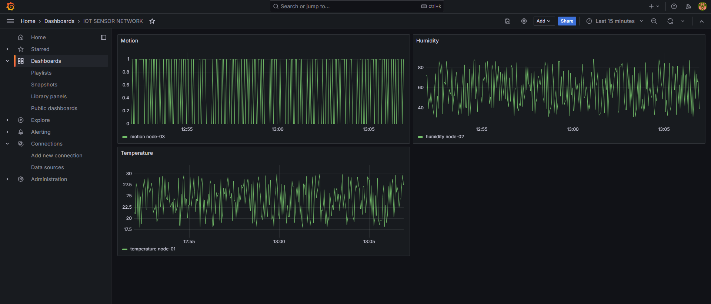
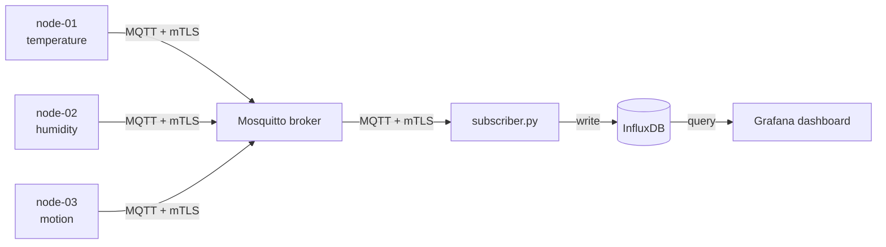

# Secure IoT-to-Cloud Sensor Network

A simulated IoT pipeline showing secure device-to-dashboard data flow. Sensor nodes publish readings over MQTT with mutual TLS, a backend stores them in a time-series database, and a dashboard visualizes them. Broker, database and dashboard run in Docker containers.



## Architecture



- `sensor_node.py` publishes simulated temperature readings (`sensors/node-01/temperature`)
- `sensor_node2.py` publishes simulated humidity readings (`sensors/node-02/humidity`)
- `sensor_node3.py` publishes simulated motion readings (`sensors/node-03/motion`)
- `subscriber.py` subscribes to `sensors/#` and writes every reading to InfluxDB
- Mosquitto, InfluxDB and Grafana run as containers defined in `docker-compose.yml`

## Why MQTT

MQTT uses a publish/subscribe model: publishers and subscribers never talk directly, only through the broker. New sensor nodes can be added without changing subscriber code, and vice versa. Adding InfluxDB and Grafana required no changes to the sensors or the broker.

## Security

- TLS 1.3 on the only listener (port 8883); there is no plaintext port
- Mutual TLS: every device holds a certificate signed by a project CA
- The certificate CN is used as the MQTT username
- Topic ACLs: each node can only publish under its own `sensors/<node>/` topic

Full analysis, including tested attack scenarios and limitations, is in [THREAT_MODEL.md](./THREAT_MODEL.md).

## Setup

Prerequisites: Docker Desktop, Python 3.10+, OpenSSL (included with Git for Windows).

1. Create the Python environment:
```
   python -m venv venv
   venv\Scripts\activate
   pip install -r requirements.txt
```
2. Generate certificates into `certs/` (they are gitignored): a CA, a server certificate with `CN=localhost`, and one certificate each for `node-01`, `node-02`, `node-03` and `subscriber`, all signed by the CA.
3. Copy `.env.example` to `.env` and set your own passwords and token.
4. Start the containers:
```
   docker compose up -d
```

## Running

With the containers up, start each of these in its own terminal (venv active):

```
python subscriber.py
python sensor_node.py
python sensor_node2.py
python sensor_node3.py
```

Grafana: http://localhost:3000 | InfluxDB: http://localhost:8086

## Roadmap

- [x] Week 1: MQTT pub/sub with simulated nodes
- [x] Week 2: mTLS, identity-based auth, ACLs, threat model
- [x] Week 3 (part 1): Dockerized broker, InfluxDB storage, Grafana dashboard
- [ ] Week 3 (part 2): Deploy to a cloud VM
- [ ] Week 4: Demo video, write-up, final polish